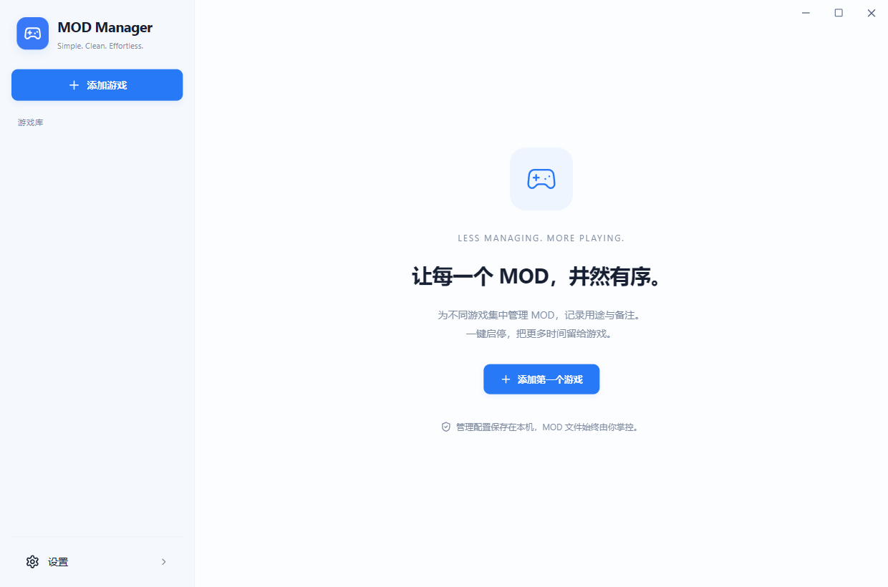
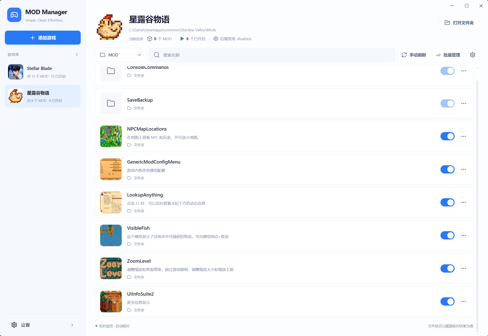
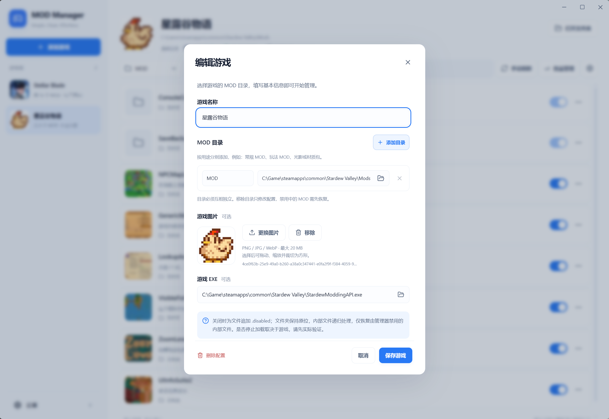
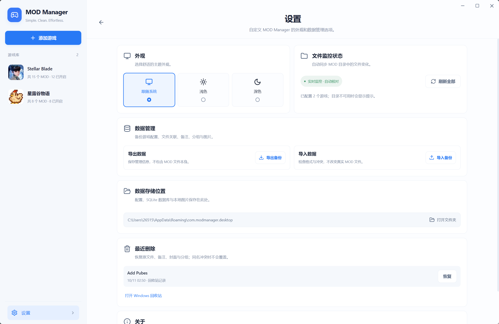

# MOD Manager

一款简洁的 Windows 本地游戏 MOD 管理器。集中管理多个游戏、多个 MOD 目录，让启停、备注和封面整理更方便。

**完全本地运行 · 无需登录 · Windows 10 / 11 x64 · MIT 开源**

[下载 Windows 程序](https://github.com/8Cola/MOD-Manager/releases/latest) · [报告问题](https://github.com/8Cola/MOD-Manager/issues) · [参与开发](CONTRIBUTING.md)



## 界面截图

### MOD 列表



### 游戏编辑



### 设置页面



## 功能

- 一个游戏可配置多个目录，并为目录设置备注名，例如普通 MOD、玩法 MOD、光影和材质包。
- 文件、压缩包及文件夹型 MOD 的一键启停；多文件自动识别和手动分组；批量操作与逐项结果。
- 中文备注、名称搜索、实时目录监控、缺失与异常状态提示。
- 游戏图片与 MOD 封面：文件选择、剪贴板粘贴、方形裁切；MOD 封面可查看保存的原图。
- 将文件或文件夹拖入当前目录页即可复制导入，保留来源，同名不覆盖。
- 真实文件／文件夹改名、移入 Windows 回收站、最近删除与恢复。
- 系统／浅色／深色外观；本地 SQLite 持久化；版本化配置备份与恢复。

## 下载与使用

在 [Releases](https://github.com/8Cola/MOD-Manager/releases) 下载 `MOD Manager.exe`，双击运行，无需安装本软件。需要 Windows 10 / 11 x64 和 Microsoft Edge WebView2 运行环境；EXE 内嵌前端资源，不需旁置网页或 DLL。

1. 添加游戏，选择游戏实际加载 MOD 的目录。可添加多个目录及备注名。
2. 在目录下拉框切换当前管理的内容。新文件会被扫描识别；不明确的项目需要在详情中确认纳入管理。
3. 使用开关启停，或进入批量管理。点击条目可编辑备注和封面；备注需点击“保存信息”。
4. “改名”修改真实文件或文件夹名称。删除会先确认，再尝试移入 Windows 回收站。
5. 在设置中导出备份。备份包含配置、备注、分组和图片，不包含实际 MOD 文件。

## 文件操作规则

启停统一使用 `.disabled` 后缀：普通文件和压缩包修改自身后缀；文件夹保持原位，递归处理内部文件。开启时恢复由管理器禁用的文件，原本已禁用的文件不会被擅自开启。

**游戏是否忽略 `.disabled` 文件取决于游戏或加载器，请先在独立目录试用并验证加载行为。** 改名也可能影响 MOD 内部引用或游戏的固定名称匹配。

软件会检查授权路径、同名冲突、文件身份、链接和配置的游戏运行状态；多文件操作记录恢复信息，失败时尽量回滚。关闭文件夹后再加入新文件会显示状态不一致，不会悄悄禁用新文件。删除游戏配置不会删除真实游戏或 MOD 文件。

回收站操作仅支持本地固定磁盘；网络盘和可移动磁盘暂不支持回收。程序运行数据保存在 `%APPDATA%\com.modmanager.desktop`，可在设置中打开。请优先使用导出备份功能；手动备份数据库应先退出程序并保留相关 WAL 文件。

## 从源码运行

准备 Node.js 22 LTS、Rust（版本见 `rust-toolchain.toml`）、Microsoft C++ Build Tools、Windows SDK 和 WebView2。使用 Windows MSVC Rust 工具链。

```powershell
npm ci
npm run desktop
```

类型检查、构建与测试：

```powershell
npm run build
cargo test --locked --manifest-path src-tauri/Cargo.toml --lib
npm run release
```

Release EXE 位于 `src-tauri/target/release/mod-manager.exe`。当前配置生成独立 EXE，不生成安装包。`scripts/package_release.py` 可整理 EXE、干净源码压缩包和 SHA-256 校验文件。

`_local/` 是本机辅助工具、缓存和临时数据，不属于开源源码。普通开发者不需要它；依赖锁定文件、构建脚本和必要测试资源均已提交。

## 文档与验证

- [测试说明](docs/TESTING.md)
- [启停性能与测试结果](docs/TOGGLE-PERFORMANCE.md)
- [封面与原图](docs/ORIGINAL-COVER.md)
- [手动保存备注](docs/MANUAL-NOTES.md)

本地 Windows 回归包含 96 项通过测试，以及真实 WebView 文件操作验收。结果针对测试环境，不代表所有游戏或 Windows 环境均已验证。Windows Release 未进行代码签名。

## 开源许可

项目代码使用 [MIT License](LICENSE)。第三方组件保留各自的许可证；Lucide 图标许可见 [THIRD_PARTY_NOTICES](THIRD_PARTY_NOTICES.md)。本项目不附带游戏 MOD、游戏资源或下载服务，与游戏发行方及 Nexus Mods 无隶属关系。
